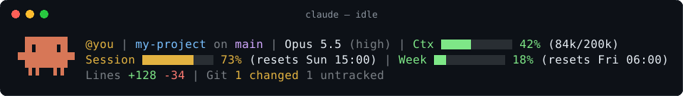

<div align="center">

# 🧡 clawd-statusline

**A colourful three-line status line for [Claude Code](https://claude.com/claude-code), with Clawd typing away while Claude works.**




</div>

## 👀 What it looks like

⌨️ **While Claude is working**, Clawd sits at a laptop, taps the keys with one hand and then the other, and blinks now and then (see the animation above).

😌 **When the turn ends**, Clawd puts the laptop away and waits:



## ✨ What it shows

| Line | What you see |
| --- | --- |
| 1️⃣ | 👤 your Claude account · 📁 folder · 🌿 git branch · 🧠 model and effort level · 📊 context window use |
| 2️⃣ | ⏱️ 5-hour session use · 📅 7-day use, each with its reset time |
| 3️⃣ | ✏️ lines added and removed this session · 🔀 git status (changed, untracked, ahead ↑, behind ↓, stashes) |

🟢 Bars are green, turn 🟡 yellow at 70% and 🔴 red at 90%.

> [!NOTE]
> Session and week usage only appear when you sign in to Claude Code with a Claude.ai subscription.

🔒 The account name comes from your own Claude Code login on your own machine. Nothing is sent anywhere.

## 📦 Requirements

- 🤖 Claude Code
- 🐚 `bash`, `git` and [`jq`](https://jqlang.org/download/)
  - 🍎 macOS: `brew install jq`
  - 🐧 Linux: `sudo apt install jq` (or your package manager)
  - 🪟 Windows: `winget install jqlang.jq`, then run the installer from Git Bash (it comes with [Git for Windows](https://git-scm.com/download/win))
- 🔤 A terminal font with Unicode block characters (almost all have them)

## 🚀 Install

```bash
git clone https://github.com/Cupjok/clawd-statusline.git
cd clawd-statusline
./install.sh
```

Then start a new Claude Code session. 🎉

What the installer does:

- 📂 copies two scripts to `~/.claude/clawd-statusline/`
- ⚙️ adds `statusLine` and a few hooks to `~/.claude/settings.json`
- 💾 backs up `settings.json` first and keeps all your other hooks and settings
- ♻️ saves the status line you had before, so uninstall can bring it back

### 👥 More than one Claude config folder

If you run a second account with `CLAUDE_CONFIG_DIR`, install into each folder:

```bash
./install.sh --config-dir ~/.claude-work
```

Each folder shows its own account and usage.

## 🎛️ Options

Set these environment variables before you start Claude Code:

| Variable | Effect |
| --- | --- |
| `CLAWD_SHOW_ACCOUNT=0` | 🙈 Hide the account name (handy for screenshots and streams) |
| `CLAWD_ANIMATE=0` | 🧘 Keep Clawd still |

## 🗑️ Uninstall

```bash
./install.sh --uninstall
# or, for another config folder:
./install.sh --config-dir ~/.claude-work --uninstall
```

## 🛠️ How the animation works

1. 🪝 Claude Code hooks call `clawd-state.sh busy` when you send a prompt or a tool runs.
2. 🛑 They call `clawd-state.sh idle` when the turn stops, a permission prompt opens, or the session ends.
3. 🚩 The hook writes or deletes a small flag file named after the session id.
4. 🔁 The status line checks that flag, and `refreshInterval: 1` redraws it every second.
5. ⌛ A flag older than 10 minutes is ignored, so Clawd stops typing if a turn is cancelled.

🍏 Apple Terminal leaves gaps between rows of block characters, so there Clawd is drawn with a background colour instead.

## 🧪 Tested on

- ✅ macOS (Terminal, iTerm2) with bash 3.2
- 🤞 Linux and Windows (Git Bash) use the same script with GNU `date` and `stat` fallbacks

Something looks off on your system? 🐛 [Open an issue](https://github.com/Cupjok/clawd-statusline/issues).

## 💬 Notes

This is an unofficial fan project. It is not made or endorsed by Anthropic. Clawd and Claude belong to Anthropic.

## 📄 License

[MIT](LICENSE) 🧡
